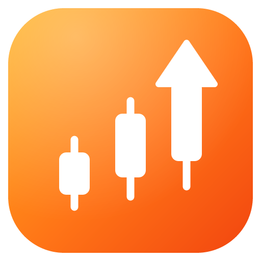
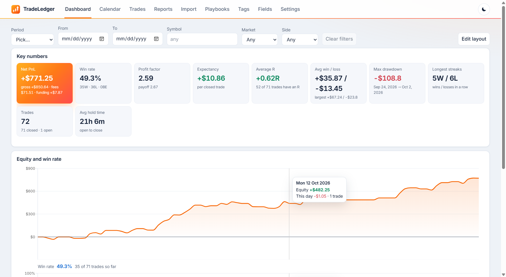
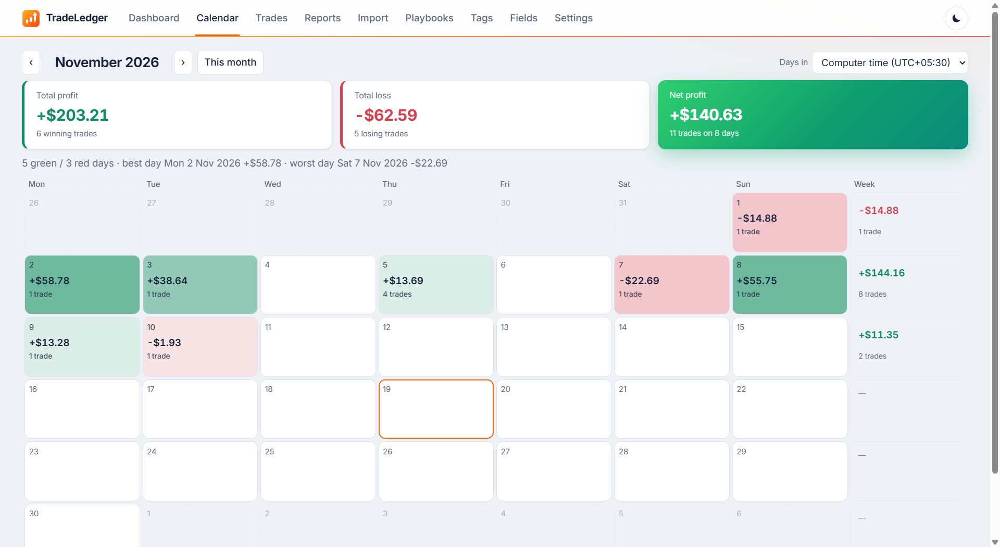
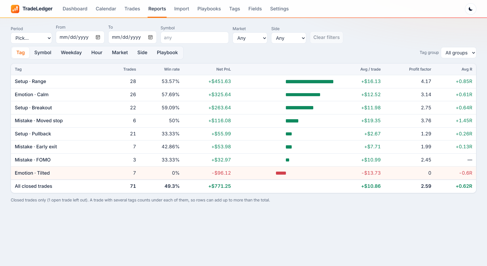
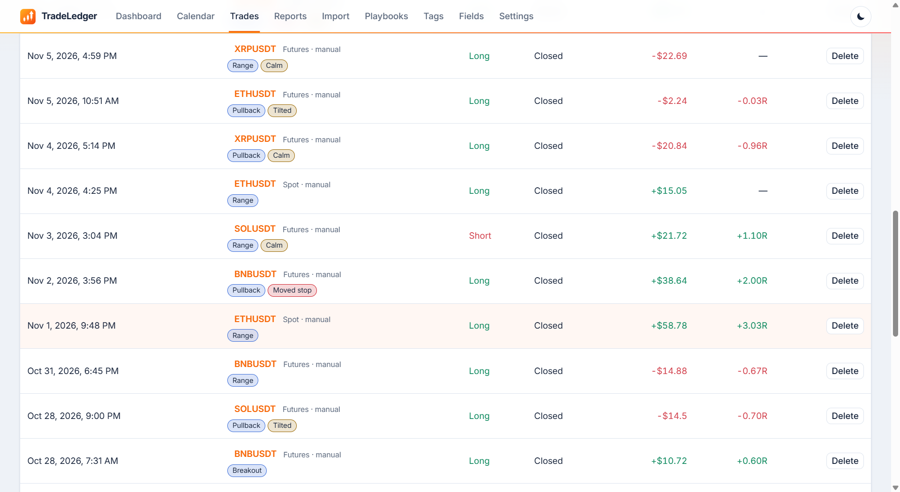
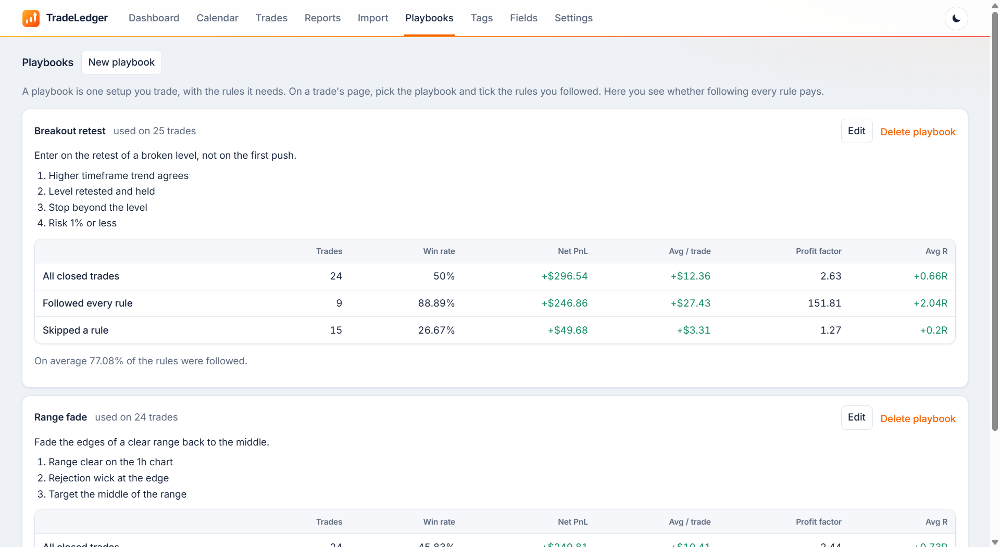
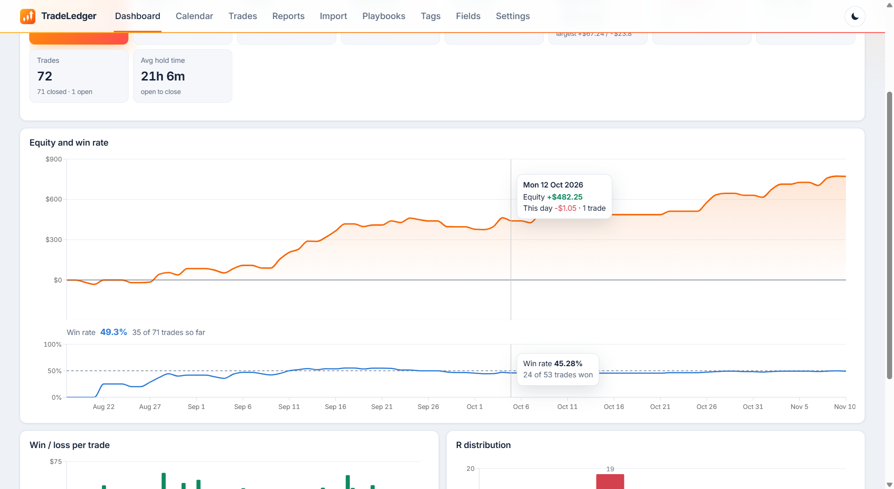
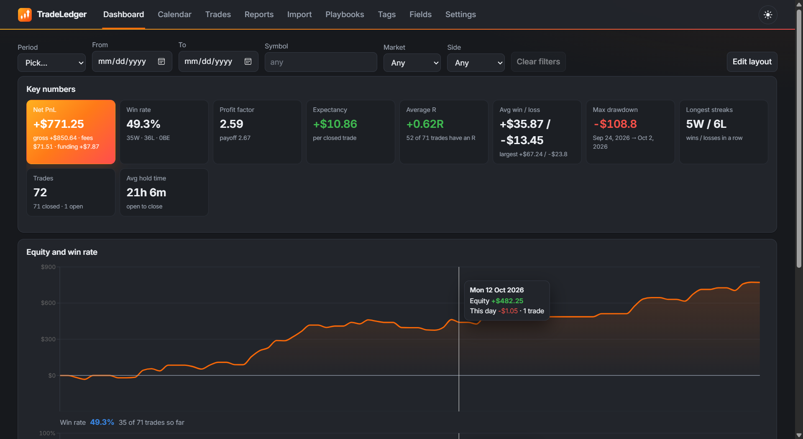

<p align="center"></p>

# TradeLedger

> A free, open-source, offline **crypto trading journal** for your desktop. Import your Binance trades, plan your risk, tag your setups and mistakes, and see what actually makes you money.

 [](https://github.com/Dimuth-Wick/tradeledger/actions/workflows/ci.yml)  



<sub>All screenshots use made-up demo data (see [Demo data](#getting-started-development)).</sub>

## Features

- 📥 **Import** Binance spot and USDT-M futures trade history (CSV), or add trades by hand with **position size in USDT** (quantity and the 0.1% fee are worked out for you)
- 🧮 **Automatic trade grouping**: partial fills become one trade, with manual merge/split; fees and funding are included in net PnL
- 🎯 **Risk plan per trade**: entry, stop loss, take profit → planned R:R and actual R-multiple
- 📊 **Dashboard**: win rate, profit factor, expectancy, average win/loss, max drawdown, streaks, a **daily equity curve with the running win rate**, win/loss bars and the R distribution, in drag-and-drop, resizable widgets
- 📅 **PnL calendar** with monthly total profit, total loss and net, in your time zone
- 🏷️ **Tags, notes (Markdown), screenshots and custom fields** on every trade
- 📈 **Reports** by tag, coin, weekday, hour, market, side and playbook
- 📘 **Playbooks**: setup checklists on each trade, and whether following every rule pays
- 🎨 **Themes**: light / dark / follow Windows, with an accent color
- 🔒 **Private by design**: everything stays in a local SQLite file; one-click **backup & restore** (.zip) and **CSV export**

## Screenshots

| Calendar                                                                                     | Reports                                                                    |
| -------------------------------------------------------------------------------------------- | -------------------------------------------------------------------------- |
|              |                     |
| **Trade log**                                                                                | **Playbooks**                                                              |
|                           |  |
| **Equity and win rate**                                                                      | **Dark mode**                                                              |
|  |              |

## Tech stack

| Part        | Tech                                                      |
| ----------- | --------------------------------------------------------- |
| Desktop app | [Tauri 2](https://tauri.app)                              |
| Core logic  | Rust (SQLite via rusqlite, `rust_decimal` for money math) |
| UI          | React + TypeScript + Vite                                 |

## Privacy

TradeLedger has no server and no account. Your trades are stored in your OS app-data folder (`%APPDATA%\TradeLedger` on Windows), never sent anywhere. API keys are not needed in v1.

## Download

Installers for Windows, macOS and Linux are on the [Releases](https://github.com/Dimuth-Wick/tradeledger/releases) page. They are not code-signed yet: on Windows choose **More info → Run anyway**; on macOS right-click the app and choose **Open** the first time.

Releases are built by GitHub Actions (`.github/workflows/release.yml`) when a version tag such as `v1.0.0` is pushed; every push to `main` also runs the tests (`ci.yml`).

## Getting started (development)

### 1. Install the system tools (once per computer)

| Tool                                 | Version        | Why                                                        |
| ------------------------------------ | -------------- | ---------------------------------------------------------- |
| [Node.js](https://nodejs.org)        | LTS (22+)      | Runs the UI tooling (Vite, TypeScript, ESLint)             |
| [Rust](https://rustup.rs) via rustup | stable (1.85+) | Compiles the core                                          |
| Tauri prerequisites                  | —              | [OS-specific list](https://tauri.app/start/prerequisites/) |
| Git                                  | any recent     | Clone the repo                                             |

On **Windows** (PowerShell), the Tauri prerequisites are the MSVC Build Tools + WebView2 (WebView2 is already part of Windows 10/11):

```powershell
winget install --id Microsoft.VisualStudio.2022.BuildTools --override "--wait --passive --add Microsoft.VisualStudio.Workload.VCTools --includeRecommended"
winget install --id Rustlang.Rustup
winget install --id OpenJS.NodeJS.LTS
```

Restart the terminal afterwards so `cargo` and `node` are on the PATH. On macOS/Linux follow the Tauri link above.

### 2. Clone and run

```bash
git clone https://github.com/Dimuth-Wick/tradeledger.git
cd tradeledger
npm install          # JS libraries, from package.json / package-lock.json
npm run tauri dev    # Rust libraries download + compile automatically (first run takes a few minutes)
```

Library versions are pinned by `package-lock.json` and `src-tauri/Cargo.lock`; there is no separate requirements file.

### 3. Checks before committing

```bash
npm run lint && npm run format:check && npm test
cd src-tauri && cargo fmt --check && cargo clippy --all-targets -- -D warnings && cargo test
```

Your data lives in `%APPDATA%\TradeLedger` (Windows), outside the repo.

To try imports with the fake files in `tests/fixtures/` without touching your real journal, point the app at a throwaway database:

```powershell
$env:TRADELEDGER_DB_PATH = "$env:TEMP\tradeledger-test.db"; npm run tauri dev
```

To see every screen with plenty of data, create a demo database of about 70 made-up trades (three months, tags, playbooks), then open the app on it. The tool only creates new files, so it can't touch your journal:

```powershell
cd src-tauri; cargo run --example seed_demo -- "$env:TEMP\tradeledger-demo.db"; cd ..
$env:TRADELEDGER_DB_PATH = "$env:TEMP\tradeledger-demo.db"; npm run tauri dev
```

## Backups

**Settings → Your data → Back up now** saves everything (trades, journal, tags, playbooks, screenshots) into one `.zip`. **Restore from backup…** shows what a backup holds before replacing anything, and always saves your current data first to `backups\before-restore-<time>.zip` next to the database. **Export CSV** (Settings, or the trade log with its filters) writes trades for spreadsheets.

## Disclaimer

TradeLedger is a journaling and analysis tool, not financial advice.

## License

[MIT](LICENSE) © 2026 Dimuth-Wick
